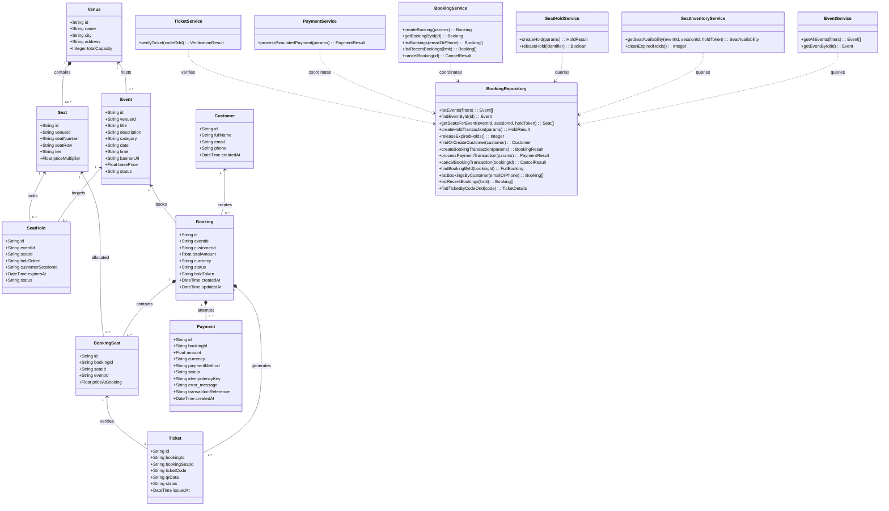

# EventEase — Domain Model & UML Class Diagram

## 1. Overview
The EventEase domain model is engineered to provide transactional integrity, concurrency safety, dynamic tier-based pricing, temporary reservation hold expiry, and cryptographic ticket verification.

---

## 2. UML Class Diagram (Mermaid)

---

## 3. Core Domain Entities & Attributes

### 3.1 Customer
- **id** (UUID/String, PK): Unique customer identifier.
- **fullName** (String): Customer full name.
- **email** (String, Unique Index): Verified customer email.
- **phone** (String): Customer contact number.
- **createdAt** (DateTime): Registration / first purchase timestamp.

### 3.2 Venue
- **id** (String, PK): Unique venue key (e.g., `venue_codissia`).
- **name** (String): Venue facility name.
- **city** (String): Host city (Coimbatore, Chennai, etc.).
- **address** (String): Physical street address.
- **totalCapacity** (Integer): Maximum capacity (default 60 seats for demo layout).

### 3.3 Event
- **id** (String, PK): Unique event key (e.g., `evt_tamil_rock_2026`).
- **venueId** (String, FK): Reference to hosting Venue.
- **title** (String): Event headline name.
- **description** (String): In-depth event description.
- **category** (String): Event category (`Music`, `Technology`, `Sports`, `Arts`, `Comedy`).
- **date** (String / Date): Event date (`YYYY-MM-DD`).
- **time** (String): Showtime (e.g., `06:30 PM`).
- **bannerUrl** (String): CDN/Unsplash cover image.
- **basePrice** (Float): Starting standard ticket price in INR.
- **status** (String): Lifecycle state (`ACTIVE`, `COMPLETED`, `CANCELLED`).

### 3.4 Seat
- **id** (String, PK): Synthetic ID (e.g., `seat_venue_codissia_A1`).
- **venueId** (String, FK): Associated venue.
- **seatNumber** (String): Alphanumeric seat label (e.g., `A1`, `B4`).
- **seatRow** (String): Row letter (`A` through `F`).
- **tier** (String): Pricing tier:
  - `VIP` (Rows A-B): 1.50× multiplier
  - `PREMIUM` (Rows C-D): 1.25× multiplier
  - `STANDARD` (Rows E-F): 1.00× multiplier
- **priceMultiplier** (Float): Server-side price factor.

### 3.5 SeatHold
- **id** (String, PK): Primary key.
- **eventId** (String, FK): Event reference.
- **seatId** (String, FK): Seat reference.
- **holdToken** (String, Indexed): Client hold session token.
- **customerSessionId** (String): Anonymous browser session UUID.
- **expiresAt** (DateTime, Indexed): Timestamp when reservation expires (NOW + 300 seconds).
- **status** (String): Hold state (`ACTIVE`, `RELEASED`, `CONVERTED`, `EXPIRED`).

### 3.6 Booking
- **id** (String, PK): Alphanumeric reference code (e.g., `BK-849201`).
- **eventId** (String, FK): Event reference.
- **customerId** (String, FK): Customer reference.
- **totalAmount** (Float): Server-side calculated sum in INR.
- **currency** (String): Default `INR`.
- **status** (String): Booking state:
  - `PENDING`: Seats held, awaiting payment submission.
  - `CONFIRMED`: Payment verified, tickets issued.
  - `CANCELLED`: Released by customer, tickets voided.
  - `EXPIRED`: Hold timed out without payment.
- **holdToken** (String): Reservation hold reference.

### 3.7 BookingSeat
- **id** (String, PK): Unique link ID.
- **bookingId** (String, FK): Booking reference.
- **seatId** (String, FK): Seat reference.
- **eventId** (String, FK): Event reference.
- **priceAtBooking** (Float): Immutable price charged at booking time.

### 3.8 Payment
- **id** (String, PK): Transaction ID (e.g., `PAY-192842`).
- **bookingId** (String, FK): Booking reference.
- **amount** (Float): Transaction value.
- **currency** (String): Default `INR`.
- **paymentMethod** (String): `DEMO_SIMULATION`.
- **status** (String): `PENDING`, `SUCCESS`, `FAILED`, `REFUNDED`.
- **idempotencyKey** (String, Unique): Prevents duplicate transactions on client retries.
- **transactionReference** (String): Audit reference code.

### 3.9 Ticket
- **id** (String, PK): Unique ticket record key.
- **bookingId** (String, FK): Booking reference.
- **bookingSeatId** (String, FK): Allocated seat junction key.
- **ticketCode** (String, Unique): Cryptographic identifier (e.g., `TKT-EE-9201-A1`).
- **qrData** (String): Verification URL encoded in SVG QR code.
- **status** (String): `VALID`, `USED`, `CANCELLED`.
- **issuedAt** (DateTime): Timestamp of issuance.

---

## 4. Multiplicities & Cardinalities

1. **Venue 1 : N Seats (`1` to `60..*`)**: Each venue contains physical seats partitioned into rows and tiers.
2. **Venue 1 : N Events (`1` to `0..*`)**: A venue can host multiple scheduled events over time.
3. **Customer 1 : N Bookings (`1` to `0..*`)**: A customer can place multiple reservations across different events.
4. **Booking 1 : N BookingSeats (`1` to `1..*`)**: A booking must contain at least one seat and can contain multiple seats.
5. **Booking 1 : N Payments (`1` to `0..*`)**: A booking tracks payment attempts (including failures, successes, and refunds).
6. **Booking 1 : N Tickets (`1` to `0..*`)**: Once a booking reaches `CONFIRMED` status, exactly one ticket is issued per reserved seat.
7. **Seat 1 : N SeatHolds (`1` to `0..*`)**: A seat can have multiple historical hold records, but only **one** `ACTIVE` hold where `expiresAt > datetime('now')` at any given time.
