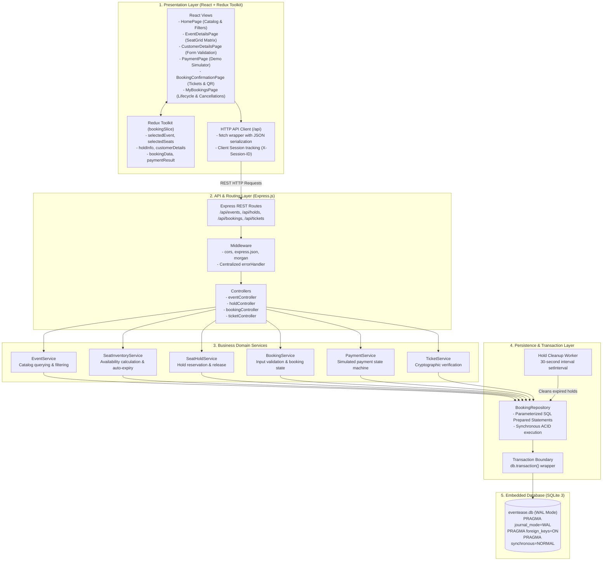

# EventEase — Low-Level Architecture (LLD)

## 1. Architectural Overview

The Low-Level Architecture (LLD) describes the structural decomposition, component boundaries, execution flow, and data persistence guarantees of **EventEase**. The application follows a strict layered architecture pattern:



---

## 2. Layer Responsibilities & Component Mapping

### 2.1 Presentation & State Layer
- **`bookingSlice.js`**: Centralized store maintaining navigation state, active filters, selected seats, temporary hold tokens, and customer contact information.
- **`api.js`**: Client-side network gateway that attaches an anonymous `X-Session-ID` header generated per browser session to correlate user holds.
- **`SeatGrid.jsx`**: High-performance interactive seat matrix implementing reactive seat state styling (Green=Available, Violet=Selected, Amber=Held, Red=Booked).
- **`TimerBanner.jsx`**: Visual 5-minute countdown timer notifying users of reservation urgency and automatically invalidating state upon expiry.

### 2.2 Controller & Routing Layer
- **`routes/*.js`**: Maps standard HTTP verbs (`GET`, `POST`, `DELETE`) to corresponding controller functions.
- **`middleware/errorHandler.js`**: Catches unhandled errors or domain exceptions, maps status codes (`400`, `404`, `409`, `410`, `500`), and formats unified JSON responses:
  ```json
  {
    "success": false,
    "error": "Seat(s) [A1] are currently held by another user",
    "statusCode": 409
  }
  ```

### 2.3 Service Layer
- **`EventService`**: Retrieves event lists, computes available seat counts, and executes category or search filters.
- **`SeatInventoryService`**: Computes real-time availability by joining physical seats with active unexpired holds and confirmed bookings.
- **`SeatHoldService`**: Coordinates temporary seat reservation with a configurable 300-second (5-minute) timeout.
- **`BookingService`**: Enforces customer data validation and creates `PENDING` bookings tied to verified hold tokens.
- **`PaymentService`**: Coordinates simulated demo payments (`SUCCESS` or `FAILED`) with idempotency key checks.
- **`TicketService`**: Validates ticket codes against database records and confirms entry authorization.

### 2.4 Repository Layer
- **`BookingRepository`**: Direct database access abstraction utilizing `better-sqlite3`. Compiles and executes parameterized queries, ensuring prevention of SQL injection vulnerabilities and zero reliance on client-submitted prices.

---

## 3. Concurrency Protection & Transaction Boundaries

### 3.1 The Race Condition Challenge
In ticket booking systems, concurrent users may attempt to reserve the same seat simultaneously (e.g., Row A, Seat 1). A naive check-then-insert pattern causes a classic double-booking race condition.

### 3.2 Immediate Atomic Transactions
To guarantee strict serializability, **EventEase** wraps seat hold operations and booking completions in `db.transaction()`:

```javascript
createHoldTransaction({ eventId, seatIds, customerSessionId, holdDurationSeconds = 300 }) {
  // 1. Lazy cleanup of expired holds
  this.releaseExpiredHolds();

  const transaction = db.transaction(() => {
    // 2. Concurrency check: Seat already CONFIRMED booked?
    const bookedConflicts = db.prepare(`
      SELECT bs.seat_id, s.seat_number FROM booking_seats bs
      JOIN bookings b ON bs.booking_id = b.id
      JOIN seats s ON bs.seat_id = s.id
      WHERE bs.event_id = ? AND b.status = 'CONFIRMED' AND bs.seat_id IN (...)
    `).all(...);
    if (bookedConflicts.length > 0) throw conflictError;

    // 3. Concurrency check: Seat already held by another active session?
    const activeHoldConflicts = db.prepare(`
      SELECT sh.seat_id, s.seat_number FROM seat_holds sh
      JOIN seats s ON sh.seat_id = s.id
      WHERE sh.event_id = ? AND sh.status = 'ACTIVE'
        AND datetime(sh.expires_at) > datetime('now')
        AND sh.seat_id IN (...) AND sh.customer_session_id != ?
    `).all(...);
    if (activeHoldConflicts.length > 0) throw conflictError;

    // 4. Release old holds by this customer session
    // 5. Insert new active holds atomically
  });

  return transaction();
}
```

If another user reserves any of the requested seats even a millisecond earlier, SQLite's transactional lock prevents the second write and throws an immediate `409 Conflict`, prompting the second user to choose alternative seats without data corruption.

---

## 4. Temporary Hold Expiry Mechanism

Seat holds have a default lifetime of **300 seconds (5 minutes)**. EventEase uses a **hybrid dual-strategy** for hold expiry:

1. **Background Interval Worker**:
   A scheduled worker (`setInterval`) runs every 30 seconds inside `server.js`, calling:
   ```sql
   UPDATE seat_holds
   SET status = 'EXPIRED'
   WHERE status = 'ACTIVE' AND datetime(expires_at) <= datetime('now');
   ```
2. **Lazy On-Demand Cleanup**:
   Every time an event's seat inventory is read or a new hold is requested, `releaseExpiredHolds()` is executed before evaluating availability. This guarantees that an expired seat is never treated as held, even if the background timer has not yet ticked.

---

## 5. Idempotency & Payment Simulation Flow

```mermaid
sequenceDiagram
    autonumber
    actor User as Attendee (Browser)
    participant Client as React + Redux
    participant API as Express Router
    participant PaySvc as PaymentService
    participant Repo as BookingRepository
    participant DB as SQLite (eventease.db)

    User->>Client: Clicks "Simulate Successful Payment"
    Client->>Client: Generates idempotencyKey (idemp_timestamp_random)
    Client->>API: POST /api/bookings/:id/payments { status: "SUCCESS", idempotencyKey }
    API->>PaySvc: processSimulatedPayment(params)
    PaySvc->>Repo: processPaymentTransaction(params)

    rect rgb(30, 41, 59)
    Note over Repo,DB: Inside db.transaction()
    Repo->>DB: Check if idempotencyKey already exists
    alt Key Already Exists
        DB-->>Repo: Return existing payment record
        Repo-->>Client: { isDuplicate: true, payment, booking }
    else New Key
        Repo->>DB: INSERT INTO payments (status='SUCCESS', idempotencyKey)
        Repo->>DB: UPDATE bookings SET status='CONFIRMED'
        Repo->>DB: UPDATE seat_holds SET status='CONVERTED'
        Repo->>DB: INSERT INTO tickets (ticket_code, qr_data, status='VALID')
    end
    end

    Repo-->>PaySvc: Return confirmed payment & issued tickets
    PaySvc-->>API: 200 OK
    API-->>Client: { success: true, tickets: [...] }
    Client->>User: Displays Verified Ticket with Live QR Code
```



If the user simulates a **FAILED payment**:
1. The transaction records `payments(status='FAILED')`.
2. The booking is marked `CANCELLED`.
3. The seat hold status is set to `RELEASED`.
4. The seats immediately return to the available inventory pool for other attendees.
